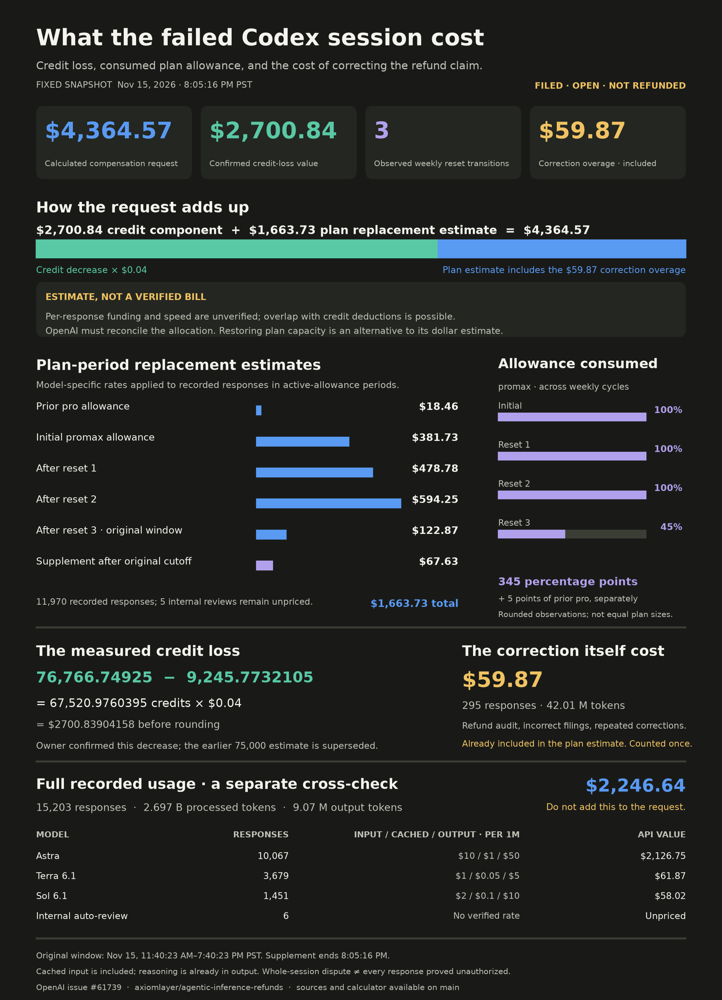

# agentic-inference-refunds

**`scope-refund` measures what an agentic coding tool spent on work you did not approve, and turns it into a refund claim backed by the provider's own usage records.**

You would not pay a contractor's invoice for the wrong scope. The same applies when Claude Code, Codex or GitHub Copilot burns hours of plan usage building something nobody asked for, or changes things you were already happy with. Every one of these tools records, per request, exactly how many tokens it used. `scope-refund` reads those records, splits them into approved and not-approved work, prices them at the provider's published API rates, and writes the claim:

- **For people:** a Markdown letter that states what was asked, what was delivered, the amount, and how it was measured.
- **For agents:** the same claim as JSON, with a published schema and stable exit codes.

The [worked example](examples/2026-11-15-wrong-scope-config-gap-analysis/) is the case that started this repo. A config gap analysis was requested and a governance reconciliation was delivered: **$211.69** of unapproved work against **$37.07** of approved work, or **$5.71 for every $1** of what was actually asked for.

A second [Codex lab-remediation example](examples/2026-11-15-codex-lab-remediation-drift/) documents repeated ZIP misdelivery, lost execution order, duplicate assembly ownership, and the cost of correcting the refund claim itself. Its **$4,364.57 calculated compensation request** combines **$2,700.84 in confirmed credit-loss value** with **$1,663.73 in provisional plan-usage replacement**, including **$59.87 in correction overage**. The evidence records three weekly reset transitions. Funding allocation remains an estimate requiring billing reconciliation; no refund approval is claimed.

## Codex refund dashboard

Snapshot: **November 15, 2026, 8:05:16 p.m. Pacific**. The dashboard and its exports are generated from the filed calculation data.

[](examples/2026-11-15-codex-lab-remediation-drift/filed/cost-chart.svg)

[Offline HTML dashboard](examples/2026-11-15-codex-lab-remediation-drift/filed/cost-chart.html) · [Full-size SVG](examples/2026-11-15-codex-lab-remediation-drift/filed/cost-chart.svg) · [Itemized calculation](examples/2026-11-15-codex-lab-remediation-drift/remedy-calculation.md) · [Filed OpenAI bug report](https://github.com/openai/codex/issues/61739)

The HTML file can be downloaded and opened locally; it has keyboard-accessible bar details, exact data tables, and source links. To regenerate the images and HTML from the calculation, run `uv run examples/2026-11-15-codex-lab-remediation-drift/build-dashboard.py`. Matplotlib is an optional dashboard-build dependency; the `scope-refund` CLI remains standard-library-only.

## Install

Python 3.11 or later, standard library only.

```sh
pipx install git+https://github.com/axiomlayer/agentic-inference-refunds
# or, from a checkout, without installing:
PYTHONPATH=src python3 -m agentic_inference_refunds --help
```

## Use

```sh
scope-refund init --out scope.toml          # 1. describe what was asked and how to split the usage
scope-refund price --claude-code SESSION.jsonl --by group   # 2. see where the money went
scope-refund claim --scope scope.toml --claude-code SESSION.jsonl --format both --out-dir claim/   # 3. the claim
```

### Where each tool keeps its usage

| Tool | Flag | Location | What is read |
|---|---|---|---|
| Claude Code | `--claude-code` | `~/.claude/projects/<project>/<session>.jsonl` (subagent and workflow transcripts beside it are included) | `message.usage` on each assistant message, de-duplicated by message ID |
| OpenAI Codex | `--codex` | `~/.codex/sessions/YYYY/MM/DD/rollout-*.jsonl`, or the folder | `token_usage_record` per response, de-duplicated by response ID; older rollouts fall back to cumulative `token_count` deltas |
| GitHub Copilot CLI | `--copilot` | `~/.copilot/session-state/<session>/` (or the whole `session-state` folder) | `session.usage_record` per model call; Copilot's own accounting snapshots are kept as a cross-check |
| Anything else | `--usage` | your export, `.jsonl` or `.csv` | the normalized record format (see `scope-refund usage`) |

Only token counts, model names, timestamps and IDs are read into the output; message content never is. Pass `--redact` to replace session, agent and request IDs and file names with hashes before sharing a claim.

### The scope file

The scope file says what was requested, what was delivered, and what evidence supports the claim. Its segments decide which usage belongs where. Each record goes to the **first** segment it matches; a match can name groups (workflow, thread or interaction type), agents, tools, models, sessions and a time window. Records no segment matches are reported as *unclassified* and are never refunded, so nothing is silently counted either way. Print the schema with `scope-refund schema scope`.

| Status | Meaning | Refundable by default |
|---|---|---|
| `approved` | Delivered the requested scope | no |
| `out_of_scope` | Work outside the requested scope | yes |
| `unrequested_change` | Changed something you had not asked to change | yes |
| `remediation` | Repairing or redoing work after a mis-delivery | yes |
| `excluded` | Left out of the claim | no |

Any segment can override the default with `refundable = true|false`.

### What the claim contains

- **Requested remedy:** the API-equivalent cost of the refundable segments, in the form you choose (extra usage credits, refund).
- **Approved versus unapproved cost:** the cost of delivering the approved scope, the cost of the work that was not approved, and the ratio between them.
- **Per-segment and per-workflow breakdown,** with subagent counts.
- **Behavior observed:**
  - how many subagents were spawned, and how many of them did unapproved work;
  - the largest spend between two human messages;
  - what was spent before your first objection, and how much of it was unapproved;
  - the reasoning share of output tokens.
- **Method and integrity:**
  - the rate cards used, with their sources and verification status;
  - a SHA-256 of every source file;
  - record counts and time span, so anyone can recompute the figures.
- **Warnings:**
  - models with no rate card (their tokens are counted, never guessed at);
  - unclassified usage;
  - unverified prices;
  - cache writes with no recorded TTL.

## For agents

```sh
scope-refund claim --scope scope.toml --codex ~/.codex/sessions --format json --strict
scope-refund schema claim     # JSON Schema of the output
scope-refund price --copilot ~/.copilot/session-state --by model --json
```

| Exit code | Meaning |
|---|---|
| 0 | OK |
| 2 | Bad input: a missing file or an invalid scope file |
| 3 | `--strict` was passed and some usage was unpriced or unclassified |

## Pricing

Each request's cost is the sum of four parts:

- uncached input × the input rate;
- cache reads × the cache-read rate;
- cache writes × the 5-minute or 1-hour write rate, depending on the recorded TTL;
- output, including reasoning, × the output rate.

The rate cards live in `src/agentic_inference_refunds/data/rates/`, and `scope-refund rates` shows them.

| Card | Status |
|---|---|
| Anthropic | Published list prices as of 2026-11-03. Rates derived from published multipliers are marked as derived. |
| OpenAI | **Unverified.** Taken from aggregators that cite OpenAI's rate sheet and disagree in places. Check before filing. |
| GitHub Copilot | **Unverified.** The legacy premium-request price. Copilot's AI-credit billing is reported from its own snapshots and is not priced. |

Override or add a model with `--rates mycard.json`, using the same shape as the bundled cards. A model in no card is reported as unpriced and never guessed. Pull requests that update a card should cite the provider's page.

The claimed amount is an **API-equivalent** figure. If the usage came out of a subscription plan, it measures the plan usage consumed in the provider's own published prices; how a provider accounts for plan usage internally is not public.

## How the parsers were checked

| Tool | Check | Result |
|---|---|---|
| Claude Code | Reproduced an independent hand tally of the worked example | Exact to the cent for every workflow |
| Codex | Per-thread usage sums against Codex's cumulative `thread_token_usage` | Matched in all 40 threads checked |
| Copilot | Premium requests (user-initiated calls × multiplier) against Copilot's own `totalPremiumRequestCost` | Matched in all 11 sessions checked |

Copilot's per-model token totals were also compared with its local `session-store.db`. They agree to within a few percent; the differences are rows the two stores hold differently. `events.jsonl` is the source of record here.

## Limitations

- Human-message detection is heuristic. It skips tool results, slash-command output, task notifications and injected context.
- Copilot's AI-credit (nano-AIU) totals are reported, not priced, until the unit price is confirmed.
- Haiku's long-prompt tier, fast mode and batch pricing are not modeled.

## License

MIT. See [LICENSE](LICENSE).
