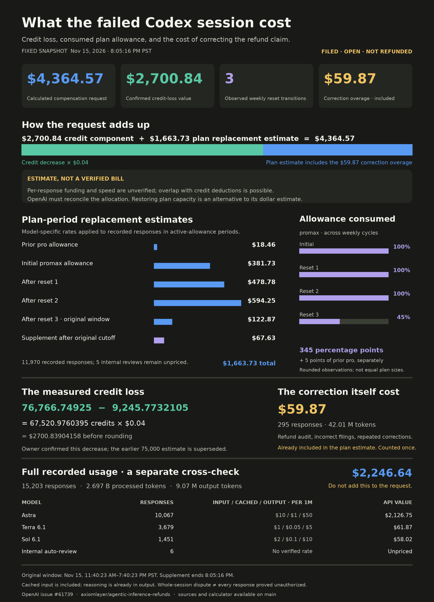

# Worked example: Codex lab-remediation drift and repeated ZIP misdelivery

This case reviews the locally available JSONL evidence for an eight-hour lab-remediation session on November 15, 2026. Agents repeatedly lost the requested product handoff, execution order and assembly ownership; the eventual coordinator added unwanted archives and HTML pages and then spent further inference repairing those decisions.

[](filed/cost-chart.svg)

[Offline HTML dashboard](filed/cost-chart.html) · [Full-size SVG](filed/cost-chart.svg) · [PNG](filed/cost-chart.png) · [Dashboard generator](build-dashboard.py)

The dashboard is generated from `remedy-calculation.json`, `remedy-inputs.json`, and `rates-openai.json`; its fixed snapshot ends November 15 at 8:05:16 p.m. Pacific. The HTML includes keyboard-accessible bar details, exact period tables, and source links. Regenerate it with `uv run build-dashboard.py` after regenerating the calculation. The optional plotting dependency does not change the CLI's standard-library-only installation.

**Filed:** [OpenAI Codex #61739](https://github.com/openai/codex/issues/61739). The calculated compensation request is **$4,364.57**: **$2,700.83904158 in confirmed credit-balance loss plus $1,663.7266254 in estimated plan-usage replacement**, including the refund-audit and repeated-correction overage. [Itemized math and limits](remedy-calculation.md) · [reproducible calculator](calculate-remedy.py) · [source-linked inputs](remedy-inputs.json). No refund has been approved or processed. [Corrected submitted body](filed/corrected-issue.md) · [original superseded body](filed/issue.md) · [submission receipt](filed/receipt.json).

The inventory covers **4,133 local JSONL paths**. Globally deduplicated records contain **14,777 OpenAI responses / 2,618,064,476 processed tokens**, including cached input. The full OpenAI population remains within the disputed session for reimbursement review. Its standard API benchmark is **$2,179.01**, plus six unpriced internal responses. Actual credit restoration requires provider billing records.

**The original $19.70 requested remedy is withdrawn.** The assistant imposed fifteen narrow selectors and improperly excluded unresolved activity alongside authorized work. [The corrected claim](claim.md) covers the full disputed session. The owner confirmed the measured loss of 67,520.9760395 credits, superseding the earlier 75,000 estimate. Three reset transitions are evidenced; consumed plan capacity is included separately. [The exclusion accounting](exclusions.md) identifies the $2,159.30 discarded by the original catch-all. Historical calculation files preserve the mistake; their exclusion labels are not the current claim.

- [Full report](full-report.md): findings, timeline, accounting, counterevidence, coverage limits and requested remedy.
- [Corrected claim](claim.md) and [machine-readable claim](claim.json): full disputed population, actual-credit remedy and correction of the prior narrowing.
- [Evidence ledger](evidence.md) and [structured evidence](evidence.json): original file identifiers, line numbers and timestamps, with privacy redactions.
- [Every-file inventory](coverage.csv) and [conversation review dispositions](review-coverage.csv): coverage including exclusions.
- [Historical scope](historical-scope.toml), [redacted usage](usage.jsonl), [verified pricing](rates-openai.json) and [expected historical totals](expected.json): reproduce the withdrawn subset calculation; usage counts remain valid.
- [Counter reconciliation](counter-reconciliation.json): the 90 thread-level usage cross-checks, with redacted identifiers.
- `filed/`: exact issue text and verified submission receipt after filing.

Original transcripts and account/billing identifiers remain local. The dollar benchmark does not establish actual subscription-credit deductions. The owner requested a refund; only OpenAI can adjudicate or process it.

From the repository root, reproduce the historical subset calculation with the installed CLI. This does not generate the current actual-credit remedy:

```sh
scope-refund claim --scope examples/2026-11-15-codex-lab-remediation-drift/historical-scope.toml --usage examples/2026-11-15-codex-lab-remediation-drift/usage.jsonl --rates examples/2026-11-15-codex-lab-remediation-drift/rates-openai.json --format both --out-dir build/reproduced-historical-subtotal
```

The internal `codex-auto-review` model has no verified public price and remains in the disputed review population without a dollar estimate. The historical calculation excluded it; strict mode flags those six unpriced records. The dataset must not be presented as fully priced.
