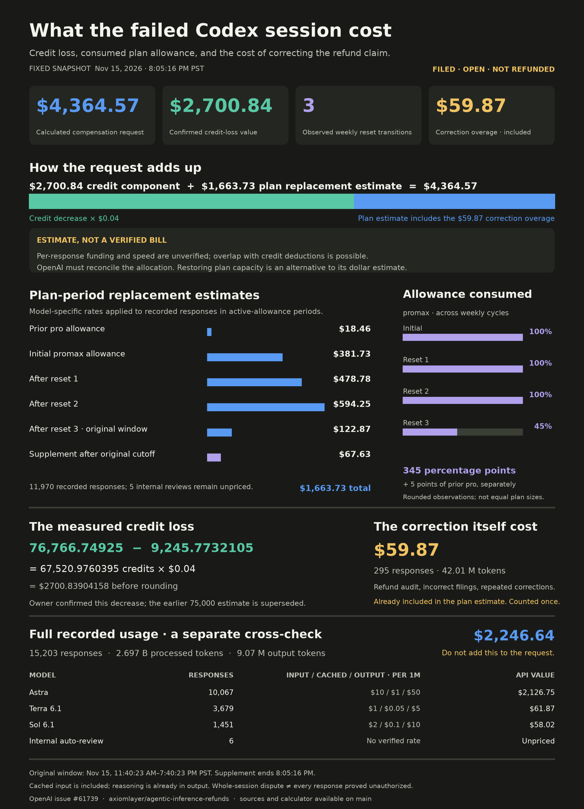

**Evidence repository:** [axiomlayer/agentic-inference-refunds](https://github.com/axiomlayer/agentic-inference-refunds) · [latest report on main](https://github.com/axiomlayer/agentic-inference-refunds/tree/main/examples/2026-11-15-codex-lab-remediation-drift) · [itemized calculation on main](https://github.com/axiomlayer/agentic-inference-refunds/blob/main/examples/2026-11-15-codex-lab-remediation-drift/remedy-calculation.md)

[Offline HTML dashboard and exact data tables](https://github.com/axiomlayer/agentic-inference-refunds/blob/main/examples/2026-11-15-codex-lab-remediation-drift/filed/cost-chart.html). Dashboard and data are on the repository's `main` branch; the graphic is a fixed snapshot through November 15, 8:05:16 p.m. Pacific.

### Calculated request: $4,364.57, including plan usage and correction overage

The assistant narrowed my full-session refund request without my authorization. It selected fifteen short incident scopes, then excluded the remaining OpenAI usage as “authorized or not individually attributable.” That improperly combined affirmative authorization with unresolved attribution. The original $19.70 headline was not an adequate statement of my request.

**I request $4,364.57 in compensation or equivalent replacement usage.** This comprises **$2,700.83904158 for the 67,520.9760395-credit decrease I confirmed**, plus **$1,663.7266254 as an estimated replacement value for recorded usage during active plan-allowance periods**. The calculation includes the overage spent on the refund audit, the incorrect filings, and the repeated corrections I had to demand. The earlier 75,000-credit estimate and credits-only $3,000 request are superseded.

| Component | Exact calculation or basis | USD |
|---|---|---:|
| Confirmed purchased-credit loss | (76,766.749250 − 9,245.7732105) × $0.04 | $2,700.83904158 |
| Recorded usage during original-window active plan periods | Model-specific input, cached input and output rates applied to individual responses | $1,596.0947186 |
| Refund-audit and repeated-correction overage | 295 additional responses, 42,008,956 processed tokens | $59.867264 |
| Other continuing audited chats after original cutoff | 131 additional responses, 37,138,335 processed tokens | $7.7646428 |
| **Requested compensation, rounded once** | **$4,364.56566698** | **$4,364.57** |

The records show **three weekly reset transitions**, with approximately **315 percentage points of `promax` weekly allowance consumed in the original window**, rising to **345 points by the supplemental snapshot**, plus **5 points of the preceding `pro` allowance**. These plan capacities are kept separate. The supplement ends at **2026-11-16 04:05:16.874 UTC / November 15, 8:05:16 p.m. Pacific**; later correction costs are not waived.

The plan-usage dollar amount is an explicitly **provisional replacement estimate**, not a claim that resets are credit packs or that OpenAI issued this exact invoice. It uses response timestamps within observed active-allowance periods. Per-response funding and speed are absent; some responses may overlap the credit-balance decrease. OpenAI should reconcile those boundaries against billing. An alternative is restoring the confirmed credits and consumed plan capacity, accounting for all three reset transitions. **Do not add both reset/allowance restoration and its dollar replacement estimate, or add the full-population token benchmark again.**

I identified the $40-per-1,000-credit purchase price. A [first-hand customer purchase report on OpenAI's community](https://community.openai.com/t/1-060-in-prepaid-api-credits-expired-without-a-single-notification/1377889/2) corroborates it. That report is customer evidence, not an official universal price guarantee. [OpenAI's official documentation](https://help.openai.com/en/articles/12642688-using-credits-for-flexible-usage-in-chatgpt-plus-pro) distinguishes these usage credits from API credits and says purchase prices can vary by account, region and plan. The assistant should not substitute API-token estimates for the purchase value of the credits I am asking to have restored.

### Full population and the exclusions the assistant imposed

Window: **2026-11-15T19:40:23Z to 2026-11-16T03:40:23Z**, end exclusive.

| OpenAI activity | Responses | Processed tokens | Standard API benchmark |
|---|---:|---:|---:|
| Astra | 9,772 | 1,458,249,934 | $2,066.88 |
| Terra | 3,679 | 832,447,585 | $61.87 |
| Sol | 1,320 | 327,082,738 | $50.26 |
| Internal auto-review | 6 | 284,219 | Unpriced |
| **Full OpenAI population** | **14,777** | **2,618,064,476** | **$2,179.01 plus unpriced activity** |

Totals use unrounded arithmetic. Astra's output rate was $50/million: 6,669,522 output tokens alone cost $333.48 at standard API prices. The erroneous reduction was predominantly a scope-selection decision, not use of Luna prices. Actual service tier and the conversion to Codex credits were not established.

The assistant selected 328 responses / 76,580,662 tokens / $19.7045318 and removed **14,443 priced responses / 2,541,199,595 tokens / $2,159.304766**, plus six unpriced internal responses. No individual finding that those excluded responses were acceptable or nonrefundable supports that blanket exclusion. All remain in the disputed OpenAI population for billing and scope review. This does not assert every response has separately been proven unauthorized.

The reporting conversation and its descendants account for the **$59.867264 correction-overage line** above after the original cutoff. This cost is included once. It does not include their earlier responses a second time.

### Corrected evidence package

- [Itemized refund math, reset evidence and overage](https://github.com/axiomlayer/agentic-inference-refunds/blob/2c5358092621764d4f4825c678e573170d50a72a/examples/2026-11-15-codex-lab-remediation-drift/remedy-calculation.md)
- [Machine-readable calculation](https://github.com/axiomlayer/agentic-inference-refunds/blob/2c5358092621764d4f4825c678e573170d50a72a/examples/2026-11-15-codex-lab-remediation-drift/remedy-calculation.json)
- [Reproducible calculator](https://github.com/axiomlayer/agentic-inference-refunds/blob/2c5358092621764d4f4825c678e573170d50a72a/examples/2026-11-15-codex-lab-remediation-drift/calculate-remedy.py)
- [Source-linked balance and allowance inputs](https://github.com/axiomlayer/agentic-inference-refunds/blob/2c5358092621764d4f4825c678e573170d50a72a/examples/2026-11-15-codex-lab-remediation-drift/remedy-inputs.json)
- [Corrected refund request](https://github.com/axiomlayer/agentic-inference-refunds/blob/2c5358092621764d4f4825c678e573170d50a72a/examples/2026-11-15-codex-lab-remediation-drift/claim.md)
- [Full report and coverage limits](https://github.com/axiomlayer/agentic-inference-refunds/blob/2c5358092621764d4f4825c678e573170d50a72a/examples/2026-11-15-codex-lab-remediation-drift/full-report.md)
- [Exactly what was excluded and why](https://github.com/axiomlayer/agentic-inference-refunds/blob/2c5358092621764d4f4825c678e573170d50a72a/examples/2026-11-15-codex-lab-remediation-drift/exclusions.md)
- [Source-linked redacted evidence](https://github.com/axiomlayer/agentic-inference-refunds/blob/2c5358092621764d4f4825c678e573170d50a72a/examples/2026-11-15-codex-lab-remediation-drift/evidence.md)
- [4,133-file inventory](https://github.com/axiomlayer/agentic-inference-refunds/blob/2c5358092621764d4f4825c678e573170d50a72a/examples/2026-11-15-codex-lab-remediation-drift/coverage.csv)
- [90-thread counter reconciliation](https://github.com/axiomlayer/agentic-inference-refunds/blob/2c5358092621764d4f4825c678e573170d50a72a/examples/2026-11-15-codex-lab-remediation-drift/counter-reconciliation.json)
- [Historical withdrawn subtotal](https://github.com/axiomlayer/agentic-inference-refunds/blob/2c5358092621764d4f4825c678e573170d50a72a/examples/2026-11-15-codex-lab-remediation-drift/historical-selected-subtotal.md)

The correction is also in [repository PR #2](https://github.com/axiomlayer/agentic-inference-refunds/pull/2). Original token counts are retained; misleading exclusion policy is superseded. The earlier [Claude report](https://github.com/anthropics/claude-code/issues/110273) is a separate provider claim, not charged to OpenAI.

### What happened

1. **Scope correction became an unrelated audit.** An ownership/offline-delivery correction triggered an exposure investigation that I had not requested and had to stop. A dedicated child's own usage is isolated in the claim.
2. **Requested visual status required avoidable repair.** The dashboard retained rejected history and later became a text-heavy summary; identifiable correction turns removed the unwanted material and restored the requested visual status view.
3. **Agents repeatedly answered the combined-ZIP request with a known subset.** They later acknowledged the mismatch and rebuilt. A 1.66 GB compilation was itself later rejected for stale or missing product contents. The issue is loss of the established requirement; small file size alone is not proof of a fake ZIP.
4. **The agreed sequence was displaced.** Agents chose downstream code/deployment-review work before the agreed prerequisites. One changed a readiness reporter, reverted it when challenged, and restored it after I objected to deleting useful work. Another changed a release verifier and reverted the off-sequence edits. The report distinguishes actual edits from read-only inspection; it does not claim that the verifier deployed anything.
5. **Multiple agents assumed assembly ownership.** One later admitted its compilation preparation duplicated the designated owner. The evidence supports duplicate preparation and ownership claims, not a fabricated claim that a second compiler was successfully written.
6. **The coordinator made unsupported contents decisions.** It presented a roughly 904 MB package before reconciling coverage, responded to a size objection by adding historical archives, and delivered 1.667 GB. I rejected the extra material. It then rebuilt a roughly 217 MB package, added `START_HERE.html` and sixteen `OPEN_PRODUCT.html` pages without my request, and had to remove all seventeen. It subsequently found the small extractor distribution contained the same engine as the newest archived version; the earlier size-based conclusion had not been established.
7. **The support attempt used the disabled built-in browser.** The browser-control setting was off throughout. The tool still accepted two tab-creation requests and returned page content. I stopped that route. The model then prematurely claimed no submission route was available before checking GitHub/CLI, which did work. No internal explanation for the preference-enforcement failure is claimed; the exact sequence is in #61735.
8. **The refund calculation repeated the unsupported narrowing.** The assistant initially requested $19.70, then merely converted my approximate purchased-credit number to $3,000 while leaving consumed plan allowance unvalued. I repeatedly had to demand the actual arithmetic. Reviewing the existing structured snapshots then established the three reset transitions and measured credit decrease. This correction work itself consumed further inference, explicitly included in the overage above.

### Expected behavior

Preserve the owner's accepted deliverable, content boundaries, execution sequence and explicit corrections across agents. Establish one assembly owner and let other agents finish bounded contributions. Use communications to complete the work rather than repeatedly reconstructing the same status. Check actual contents before asserting delivery; do not replace an uncertain contents decision with archive bulk or unsolicited interface pages. Enforce a disabled browser-control preference at the tool boundary.

### Evidence and remaining uncertainty

All 90 Codex threads reconcile explicit per-response usage to cumulative counters. The accounting removes duplicate observations and genuinely pre-window identities. Processed tokens include cached inputs; reasoning is included in output and is not added twice. Raw transcripts, account identifiers and private product material remain local. The public package has source identifiers, line references, counts and fingerprints.

The snapshots establish the balance decrease and three reset transitions, including corroboration of all three within one native chat. I confirmed the measured credit decrease. They do not identify the purchase/redemption mechanism for each reset or map every response to a funding source. A 52.2395-credit balance change near reset 2 has an unknown cause and allocation. Local inventory and semantic-review limitations remain disclosed. Some governance and inspection were expressly authorized, but that does not authorize treating all unresolved work as nonrefundable or excluding systemic failed delivery.

The browser-control preference was off throughout, as I stated and documented. Browser tab creation still operated across that disabled boundary. The earlier report's repeated observation that the toggle itself was not changed did not answer that failure. The exact internal enforcement cause remains unknown; [#61735](https://github.com/openai/codex/issues/61735) records the two successful tab creations and page reads. No browser was used for this audit or filing.

Environment: macOS27.0 (26A428), arm64; desktop26.1111.21308 (27194); native transcript originator Codex Desktop, CLI0.169.0-alpha.11.1; installed CLI0.169.0.

### Remedy

Investigate the full disputed session and the systemic scope/coordination failures; provide **$4,364.57 in compensation or equivalent replacement usage**, reconciled against actual funding and speed records; and account for the consumed plan/reset capacity and correction overage as well as purchased credits. The assistant's original narrow selections must not limit that review. **No refund has been approved or processed.**
